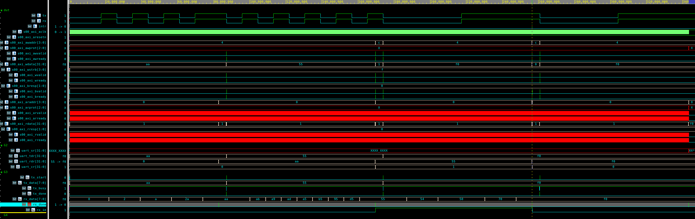

# AXI4-Lite UART (11/24)

Vivado의 AXI4-Lite IP 템플릿(`uart_v1_0`, `uart_v1_0_S00_AXI`)에 UART 송수신기를 붙이고, VCS / Verdi로 레지스터 접근과 파형을 확인한 실습입니다.
TB에서 `tx`를 `rx`에 그대로 연결(loopback)해, 보낸 바이트가 RDR로 다시 읽히는지 검사합니다.

## 구조

```
tb_AXI_UART ── AXI4-Lite Write / Read task
     │
     ▼
uart_v1_0 (top)
 ├── uart_v1_0_S00_AXI   AXI4-Lite slave + 레지스터 4개 (SR / TDR / RDR / CR)
 └── uart                uart_tx + uart_rx (100 MHz, 115200 baud, 8N1)
        tx ──(loopback)──▶ rx
intr = CR.rx_ie & rx_done
```

## 레지스터 맵

| 주소 | 이름 | 접근 | 내용 |
|---|---|---|---|
| 0x0 | SR | R | bit0 `tx_busy`, bit1 `rx_flag` (수신 완료 시 1, RDR을 읽으면 0) |
| 0x4 | TDR | R/W | 쓰면 `[7:0]`을 송신 데이터로 저장하고 `tx_start` 1클럭 펄스 |
| 0x8 | RDR | R | `rx_done` 때 수신 바이트 저장 |
| 0xC | CR | R/W | bit0 `rx_ie` (수신 인터럽트 enable) |

## 테스트 시나리오

각 단계마다 `SR.tx_busy`가 0이 될 때까지 기다린 뒤 TDR에 쓰고, `SR.rx_flag`가 1이 되면 RDR을 읽어 비교합니다.

| 순서 | CR | 송신(TDR) | 기대 |
|---|---|---|---|
| 1 | 0x0 | 0xAA | RDR = 0xAA, `intr` 없음 |
| 2 | 0x0 | 0x55 | RDR = 0x55 |
| 3 | 0x1 (rx_ie on) | 0xF0 | RDR = 0xF0, 수신 완료 시 `intr` 발생 |
| 4 | 0x0 (rx_ie off) | 0xF0 | RDR = 0xF0, `intr` 없음 |

## 파형



- `uart_tdr`가 aa → 55 → f0로 바뀔 때마다 `tx_start` 펄스가 뜨고, `tx` 파형이 그대로 `rx`에 나타납니다.
- `rx_data`가 비트 단위로 채워지다가 `rx_done`에서 `uart_rdr`이 aa → 55 → f0로 갱신됩니다.
- `uart_cr`가 1인 구간(3번)에서만 `rx_ie`가 1이 되어 `intr`이 발생합니다.
- `uart_sr`는 X로 보이는데, SR은 레지스터에 저장하지 않고 읽을 때 `{rx_flag, tx_busy}`를 바로 조합해 내보내기 때문입니다(쓰기 로직은 주석 처리).

## 실행

```bash
make          # 컴파일 + 시뮬레이션 (PASS! tdr = ..., rdr = ... 4회 출력)
make verdi    # wave.fsdb 파형 확인
make clean
```

> 원본 Makefile의 `cat pkg.f`(파일 없음)와 줄 중간 `\ ` 오류를 고쳐 소스를 직접 나열했고, TB에 `` `ifdef FSDB `` 덤프를 추가했습니다.
